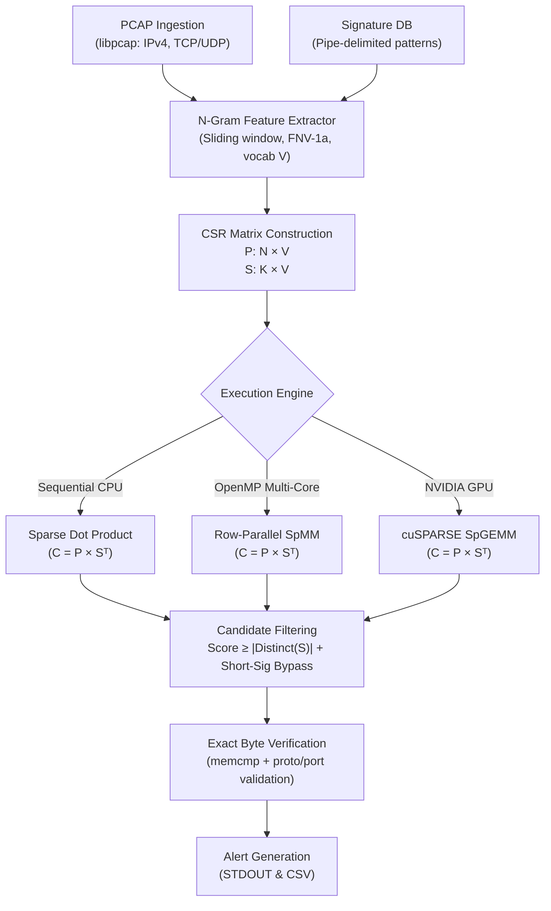

# Architecture — GPU Sparse IDS

## Overview

The system is a **pipeline** that transforms raw PCAP bytes into verified IDS alerts through a sequence of sparse linear algebra operations.



```
PCAP File
    │
    ▼
┌─────────────┐
│ PcapReader  │  libpcap — reads raw packets, extracts IPv4 TCP/UDP payloads
└──────┬──────┘
       │ vector<Packet>
       ▼
┌──────────────────────┐
│ NGramFeatureExtractor│  FNV-1a hash of byte n-grams → sorted unique feature indices
└──────┬───────────────┘
       │ vector<vector<int>>   per-packet feature lists
       ▼                       per-signature feature lists
┌─────────────┐
│ CSRBuilder  │  Builds P (N×V) and S (K×V) sparse matrices in CSR format
└──────┬──────┘
       │ CSRMatrix P, CSRMatrix S
       ▼
┌──────────────────────┐
│  SpMM: C = P × Sᵀ   │  Sequential merge / OpenMP row-parallel / CUDA SpGEMM
└──────┬───────────────┘
       │ CSRMatrix C  (N×K score matrix)
       ▼
┌────────────────────────┐
│  generate_candidates   │  threshold: score ≥ num_features(sig)
│  + short-sig bypass    │  short patterns → all-pairs bypass
└──────┬─────────────────┘
       │ vector<CandidatePair>
       ▼
┌──────────────────┐
│ verify_candidates│  exact memcmp substring search + protocol/port filter
└──────┬───────────┘
       │ vector<Alert>
       ▼
┌──────────────┐
│ AlertManager │  stdout + CSV output
└──────────────┘
```

## Module Descriptions

### PcapReader (`src/ingestion/pcap_reader.cpp`)
- Uses libpcap offline API (`pcap_open_offline`, `pcap_next_ex`)
- Supports: Ethernet (DLT_EN10MB), Linux cooked (DLT_LINUX_SLL), Raw IP (DLT_RAW)
- Validates: IP version (IPv4 only), IP header length ≥ 20, protocol ∈ {TCP, UDP}
- TCP: validates data-offset field, computes payload start correctly
- UDP: extracts 8-byte header, computes payload start
- Bounds checks: `caplen` limits, truncated packet safety
- **Not supported:** IPv6, VLAN, GRE, fragmented IP, TCP stream reassembly

### NGramFeatureExtractor (`src/features/ngram_features.cpp`)
- Sliding window of width `n` (default 3) over payload bytes
- Hash: FNV-1a 32-bit, reduced modulo `vocab_size` (default 65536)
- Output: sorted, deduplicated feature index list
- Short data (len < n): hashes full content as single feature (used for short signatures bypassed to verification)
- Empty data: returns empty feature list

### CSRBuilder (`src/sparse/csr_matrix.cpp`)
- `build_from_features`: O(nnz) construction, features must be pre-sorted and unique
- CSR invariants guaranteed: `row_ptr[0]=0`, monotone non-decreasing, `row_ptr[N]=nnz`
- `spmm_transpose`: merge-based sorted-list intersection for each (row i of A, row j of B) pair
- Complexity: O(M × N × (avg_nnz_A + avg_nnz_B)) — practical for small K (num signatures)

### CPUEngine (`src/compute/cpu_engine.cpp`)
- `run_sequential`: full pipeline, sequential, reference implementation
- `generate_candidates`: 
  - Sparse-filter: score ≥ num_features (necessary condition for exact match when pattern ≥ n-gram size)
  - Short-sig bypass: patterns shorter than n-gram size are paired with ALL packets (avoids false negatives)
- `verify_candidates`: linear scan with `memcmp`, protocol + port pre-filter

### OpenMPEngine (`src/compute/openmp_engine.cpp`)
- Feature extraction: `#pragma omp parallel for schedule(dynamic, 64)` over packets
- SpMM: `#pragma omp parallel for schedule(dynamic, 1)` over rows of P (each row is independent)
- Verification: parallel with per-thread alert vectors, merged after barrier
- No data races: each thread writes only to its own row result / alert vector

### CUDAEngine (`src/cuda/cuda_engine.cu`, compile with USE_CUDA)
- GPU SpMM via cuSPARSE `cusparseSpGEMM`
- Computes B^T on CPU (sorted CSR), uploads A and B^T, runs SpGEMM, downloads C
- RAII cleanup struct ensures GPU memory is freed even on error paths
- Zero-nnz safety: `safe_cudaMalloc` handles 0-byte allocations
- Timing: separate h2d, kernel, d2h measurements via `std::chrono`
- CPU fallback: `CUDAEngine::is_available()` returns false when no NVIDIA device

## Sparse Matrix Construction Details

```
Feature vocabulary V = 65536 (hash space)

For packet i with payload bytes b_0 b_1 ... b_L:
  For each position k = 0 to L-n:
    h = FNV1a(b_k, b_{k+1}, ..., b_{k+n-1}) mod V
    P[i][h] = 1.0

For signature j with pattern bytes p_0 ... p_M:
  Same procedure → S[j][h] = 1.0
  sig.num_features = |{unique h}|
```

## Candidate Filtering

```
C = P * Sᵀ   →   C[i][j] = |{features shared between packet i and signature j}|

Candidate condition:
  C[i][j] >= sig[j].num_features   AND   sig[j].pattern.size() >= ngram_size

Short-sig bypass:
  sig[j].pattern.size() < ngram_size  →  pair (i, j) for all i  →  verify directly
```

**Correctness guarantee:** If packet *i* contains signature *j*'s pattern as a contiguous substring AND pattern length ≥ n-gram size, then every n-gram in the pattern also appears in the packet payload. Therefore `C[i][j] = num_features(j)`, and the candidate filter passes it. The exact verifier then confirms the contiguous match. No false negatives for exact matches.

## CPU Execution Paths

```
Sequential:                           OpenMP:
  packets → extract_features            packets → extract_features_parallel
    ↓ (loop)                              ↓ (#pragma omp parallel for)
  sigs → extract_features               sigs → extract_features (sequential)
    ↓                                     ↓
  build_P, build_S                      build_P, build_S
    ↓                                     ↓
  spmm_transpose (sequential)           spmm_transpose_parallel
    ↓                                     ↓ (#pragma omp parallel for rows)
  generate_candidates                   generate_candidates
    ↓                                     ↓
  verify_candidates (sequential)        verify_candidates_parallel
    ↓                                     ↓ (#pragma omp parallel for)
  alerts                                alerts (merged from per-thread vectors)
```

## GPU Execution Path

```
CPU side:                               GPU side (cuSPARSE):
  extract_features (OpenMP)
  build_P, build_S
  build_B^T (transpose on CPU)
       │
       ├─── H2D transfer (P, B^T) ──────► d_A, d_BT
       │                                      │
       │                               cusparseSpGEMM
       │                                      │
       ◄─── D2H transfer ◄────────────── d_C (result)
       │
  generate_candidates (CPU)
  verify_candidates (CPU)
  alerts
```

